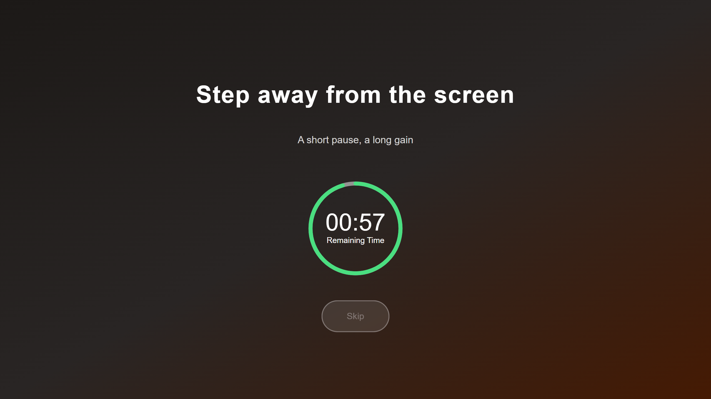
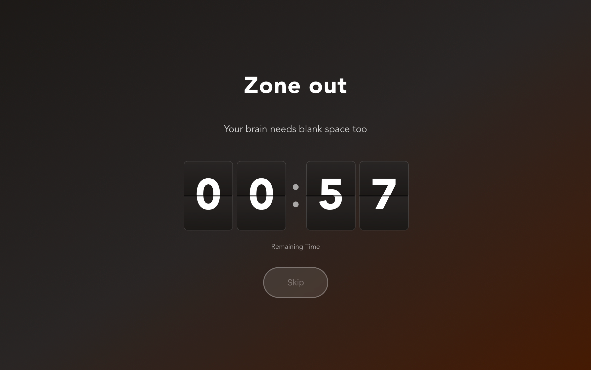
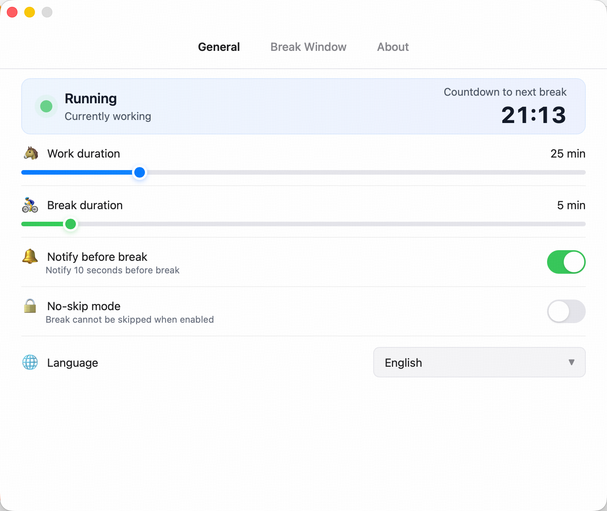
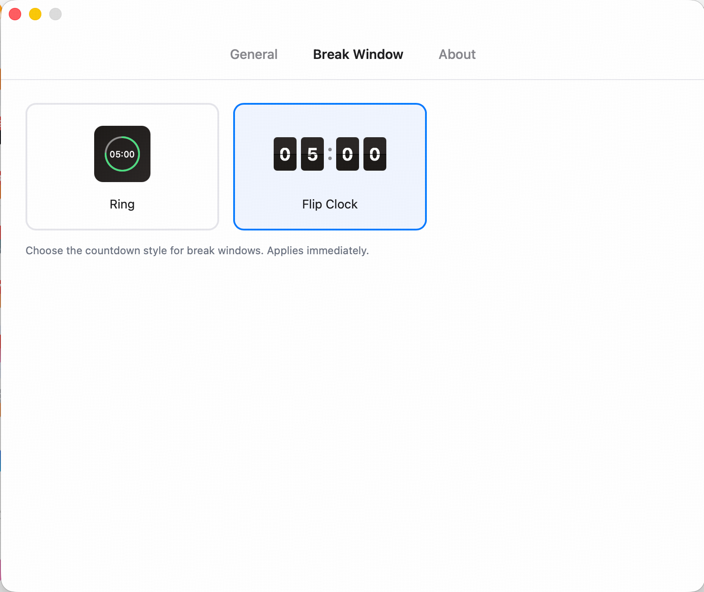
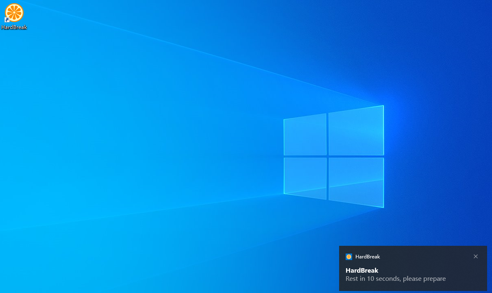
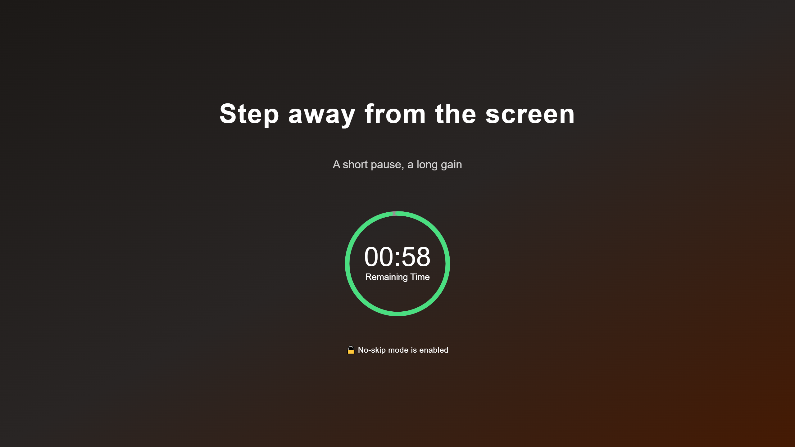

English | [简体中文](README.zh-CN.md)

# HardBreak

**Work, then actually rest.** HardBreak is a desktop Pomodoro timer: when it's time for a break, it puts a fullscreen break window on every display you own.

<p align="center">
  
  
</p>

<p align="center">
  <a href="https://apps.microsoft.com/detail/9N3DPNG7LML0">Download for Windows</a>
  ·
  <a href="https://github.com/dinghongfei/HardBreak/releases">Download for macOS</a>
</p>

<p align="center">
  
</p>

## Features

- **Pomodoro cycle.** 25/5 by default, fully adjustable (1–120 min work, 1–60 min break). Hit **Apply Now** after changing durations to restart right away.
- **Fullscreen on every display.** Each monitor gets its own break window when a break starts — even covering the fullscreen app on that screen.
- **Two countdown styles.** Ring or flip clock. Switch anytime, effective instantly.
- **A health tip every break.** 30 per language, chosen at random — hydrate, look far away, stretch, meditate…
- **Ten-second heads-up.** An optional system notification before each break, so it never catches you off guard.
- **No-skip mode.** Hides the Skip button — be a little hard on yourself.
- **Menu bar only on macOS.** Never in the Dock, never in the way.
- **Private by design.** Settings stay in a local database on this computer. No account, no reporting. See [PRIVACY.md](PRIVACY.md).

## Screenshots

| Ring countdown | Flip-clock countdown |
|---|---|
|  |  |

| General settings | Countdown style settings |
|---|---|
|  |  |

| Pre-break notification | No-skip mode |
|---|---|
|  |  |

## Download

| Platform | Get it |
|---|---|
| Windows | [Microsoft Store](https://apps.microsoft.com/detail/9N3DPNG7LML0) |
| macOS | [GitHub Releases](https://github.com/dinghongfei/HardBreak/releases) |
| Linux | Build from source (see **Development** below) |

Languages: English, Simplified Chinese, and Traditional Chinese. On first launch, HardBreak follows the system language.

## Development

Stack: [Tauri 2](https://tauri.app/) + Rust (timer, tray, multi-monitor windows) + vanilla HTML/JS (UI, no bundler) + SQLite (local settings).

Requirements: [Node.js](https://nodejs.org/), [pnpm](https://pnpm.io/), and [Rust](https://www.rust-lang.org/).

```bash
pnpm install      # install dependencies
pnpm tauri dev    # run in dev mode
pnpm tauri build  # build bundles
```

Project layout:

| Path | What lives there |
|---|---|
| `src/` | Break window and settings window UI (vanilla HTML/JS) |
| `src-tauri/` | Rust backend: timer thread, tray, windows, database migrations |
| `docs/` | Landing page and screenshots |

The app version is `version` in `src-tauri/tauri.conf.json`. `package.json` is not the app version.

## Privacy

HardBreak collects and uploads nothing; everything stays on your computer. See [PRIVACY.md](PRIVACY.md).

## Contributing

Issues and pull requests are welcome. Please keep Windows, macOS, and Linux behavior in mind for every change.

## License

[Apache License 2.0](LICENSE)
