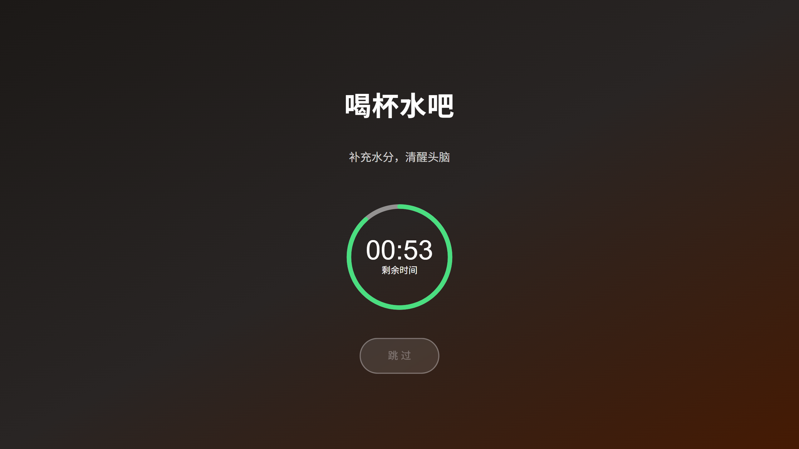
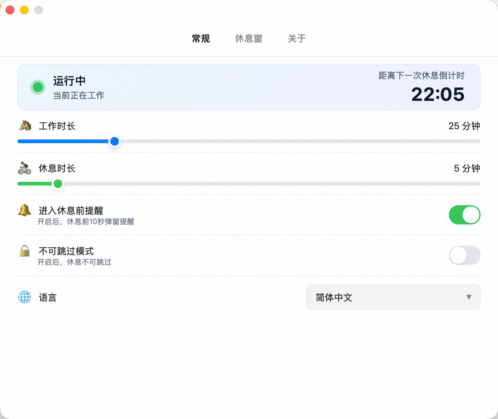
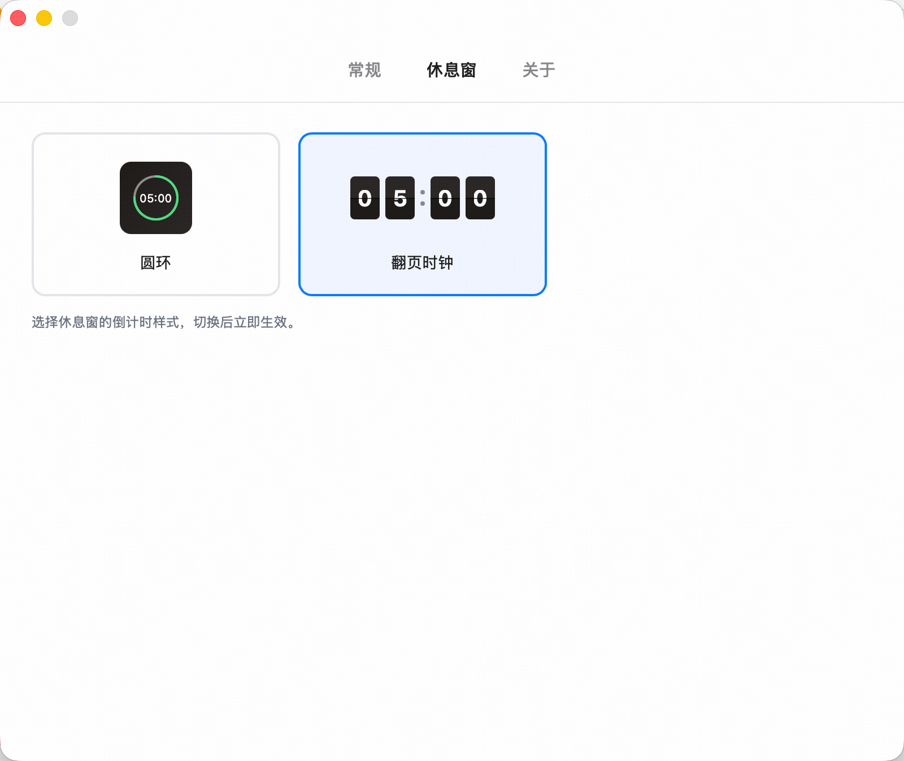
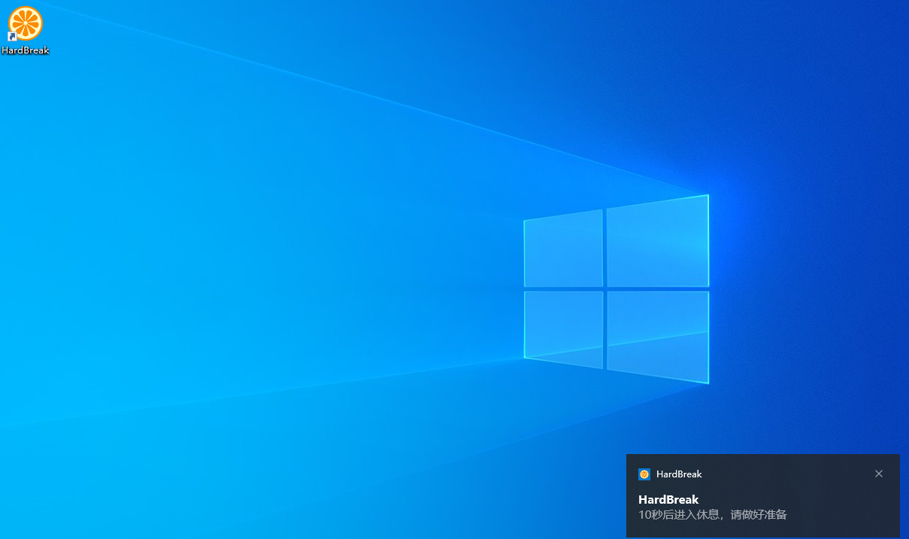
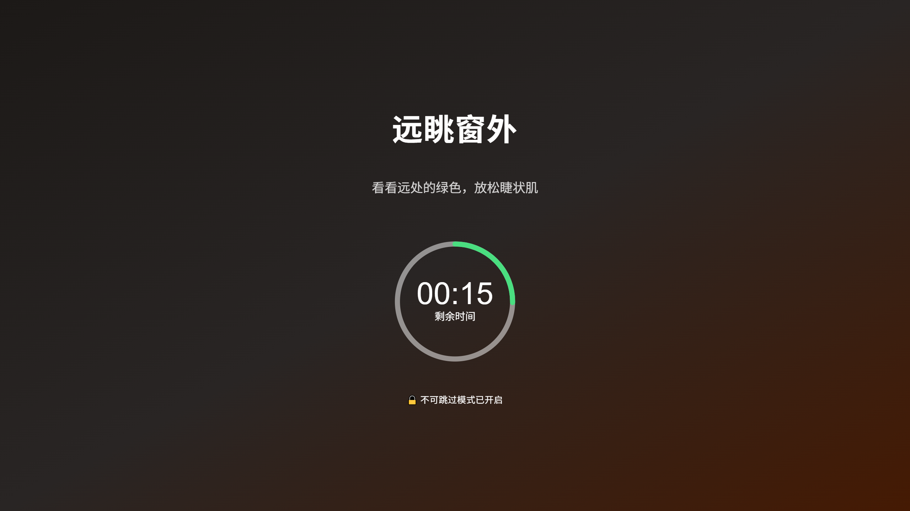

[English](README.md) | 简体中文

# HardBreak

**工作一段时间，就认真休息一下。** HardBreak 是一款桌面番茄钟：到点后，在每块显示器上弹出全屏休息窗。

<p align="center">
  
  
</p>

<p align="center">
  <a href="https://apps.microsoft.com/detail/9N3DPNG7LML0">Windows 下载</a>
  ·
  <a href="https://github.com/dinghongfei/HardBreak/releases">macOS 下载</a>
</p>

<p align="center">
  
</p>

## 功能

- **番茄循环。** 默认工作 25 分钟、休息 5 分钟，时长随心调整（工作 1–120、休息 1–60 分钟）；改完点「立即生效」，马上按新时长重新开始。
- **全屏覆盖每一块屏幕。** 休息开始时，每台显示器各弹出一扇全屏休息窗，连该屏幕上的全屏应用也能盖住。
- **两种倒计时样式。** 圆环或翻页时钟，随手切换，立即生效。
- **每次休息一条健康提示。** 三种语言各 30 条，随机出现：喝水、远眺、拉伸、冥想……
- **休息前 10 秒通知。** 可选的系统通知提前预告，让你从容收尾，不被吓一跳。
- **不可跳过模式。** 开启后休息窗没有跳过按钮——对自己狠一点。
- **macOS 只在菜单栏。** 不进程序坞，不打扰。
- **隐私至上。** 设置只存在本机数据库。没有账号，没有上报。详见 [PRIVACY.md](PRIVACY.md)。

## 截图

| 圆环倒计时 | 翻页时钟 |
|---|---|
|  |  |

| 常规设置 | 倒计时样式设置 |
|---|---|
|  |  |

| 休息前 10 秒通知 | 不可跳过模式 |
|---|---|
|  |  |

## 下载

| 平台 | 方式 |
|---|---|
| Windows | [微软商店](https://apps.microsoft.com/detail/9N3DPNG7LML0) |
| macOS | [GitHub Releases](https://github.com/dinghongfei/HardBreak/releases) |
| Linux | 从源码构建（见下文「开发」） |

界面语言有简体中文、繁体中文和英文。第一次启动时跟随系统语言。

## 开发

技术栈：[Tauri 2](https://tauri.app/) + Rust（计时、托盘、多屏窗口）+ 原生 HTML/JS（界面，无打包器）+ SQLite（本机设置）。

需要 [Node.js](https://nodejs.org/)、[pnpm](https://pnpm.io/) 和 [Rust](https://www.rust-lang.org/)。

```bash
pnpm install      # 安装依赖
pnpm tauri dev    # 开发调试
pnpm tauri build  # 打包
```

主要目录：

| 路径 | 说明 |
|---|---|
| `src/` | 休息窗与配置窗界面（原生 HTML/JS） |
| `src-tauri/` | Rust 后端：计时线程、托盘、窗口、数据库迁移 |
| `docs/` | 产品落地页与截图 |

应用版本是 `src-tauri/tauri.conf.json` 里的 `version`。`package.json` 里的版本不是应用版本。

## 隐私

HardBreak 不收集、不上传任何信息，所有数据都在你的电脑上。详见 [PRIVACY.md](PRIVACY.md)。

## 贡献

欢迎 Issue 和 Pull Request。代码改动需要同时考虑 Windows、macOS、Linux 三个平台的行为。

## 许可证

[Apache License 2.0](LICENSE)
